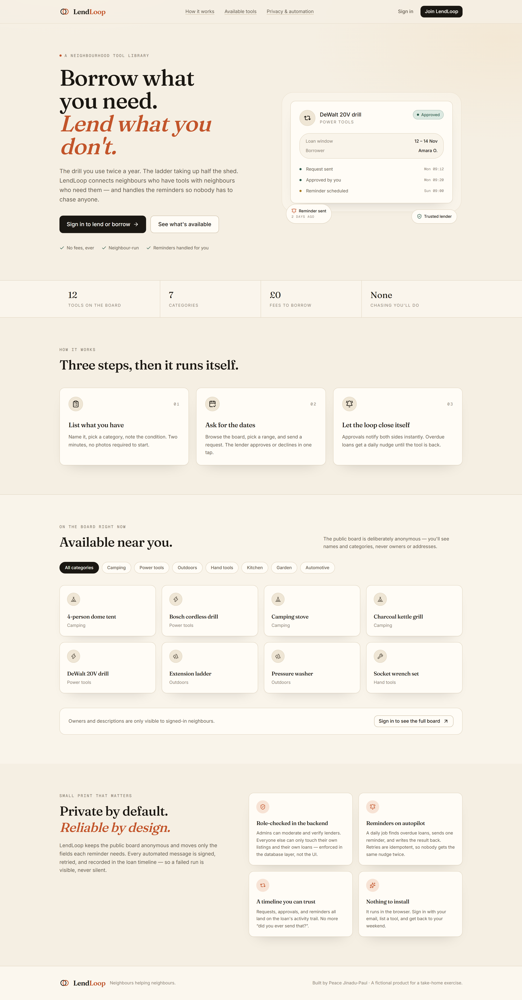
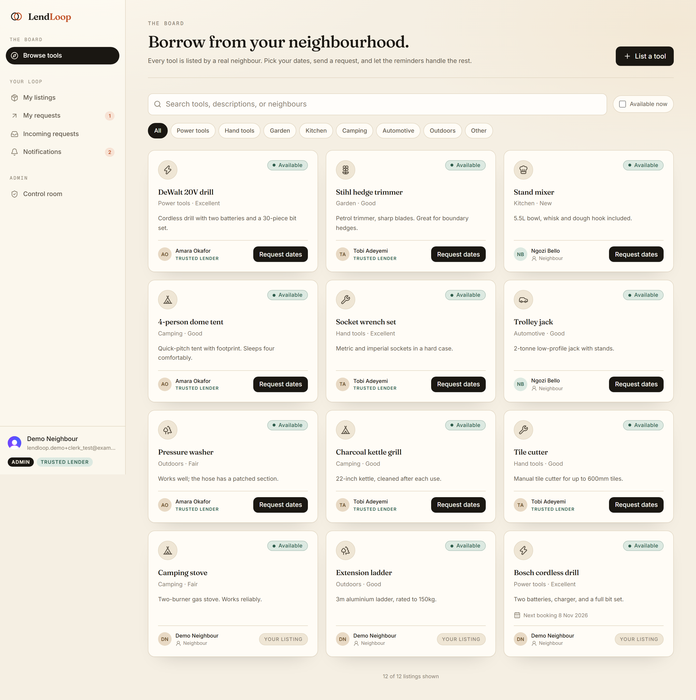
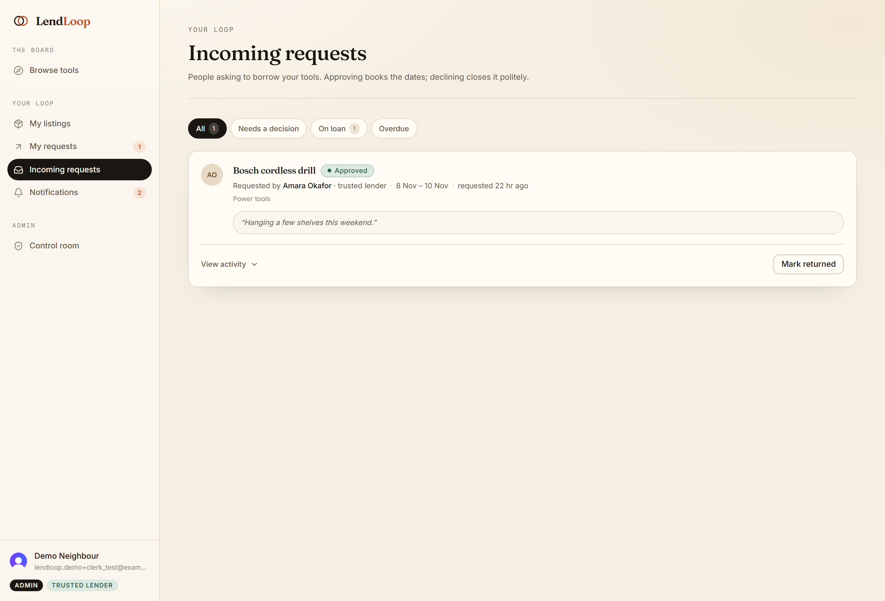
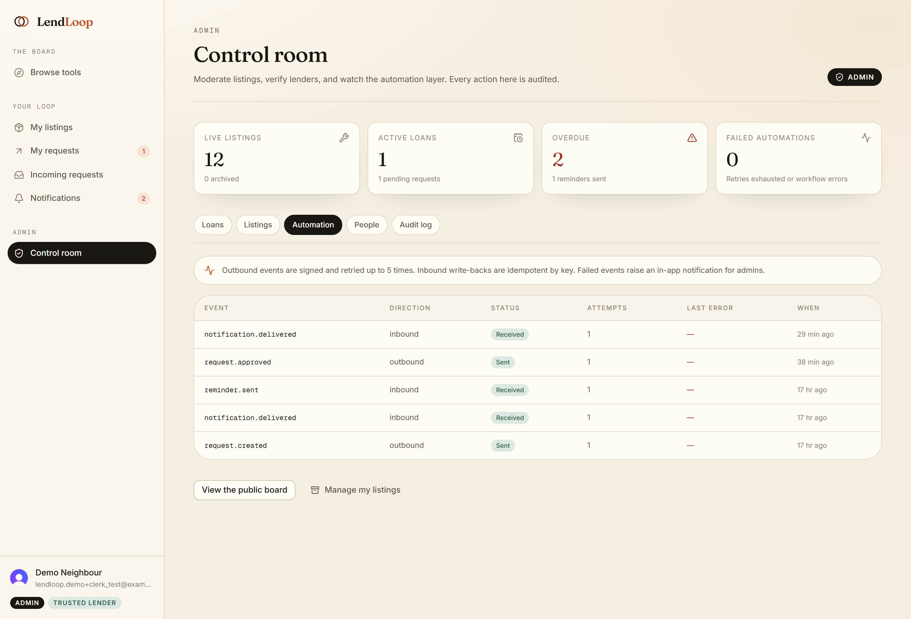
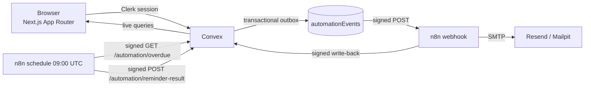

# LendLoop

**Borrow what you need. Lend what you don't.**

A neighbourhood tool-lending board where people list tools they are willing to share, request them for a date range, and let automation handle approvals, reminders, and overdue nudges.

Built with **Next.js 16 (App Router) · Clerk · Convex · n8n · TypeScript**.

| Public board | Browse (signed in) |
| --- | --- |
|  |  |

| Incoming requests | Admin automation health |
| --- | --- |
|  |  |

---

## Contents

- [What it does](#what-it-does)
- [Architecture](#architecture)
- [Security model](#security-model)
- [Automation design](#automation-design)
- [Data minimisation](#data-minimisation)
- [Local setup](#local-setup)
- [n8n setup](#n8n-setup)
- [Environment variables](#environment-variables)
- [Testing and verification](#testing-and-verification)
- [Demo script](#demo-script)
- [Project structure](#project-structure)
- [Design notes](#design-notes)
- [Production](#production)
- [Scope decisions](#scope-decisions)

---

## What it does

**Public, signed-out**

- A short pitch and a live, read-only board of available tools.
- The public projection is deliberately anonymous: **name and category only**. No owner, description, location, or condition.

**Signed in**

- Browse all tools with condition, description, owner, and availability.
- Filter by category, availability, and free-text search.
- List a tool (name, category, condition, short description), edit it, or remove it.
- Request a tool for an inclusive date range; the lender approves or declines.
- Mark an approved loan as returned.
- See in-app notifications and a per-loan activity timeline, including automation events such as `Reminder sent (2 days past due)`.

**Roles**

| Capability | `user` | `admin` |
| --- | --- | --- |
| Create / edit / delete own listings | Yes | Yes |
| Request to borrow (not own tools) | Yes | Yes |
| Approve / decline requests on own tools | Yes | Yes |
| Mark a loan returned (lender or borrower) | Yes | Yes, any loan |
| View all loans | No | Yes |
| Remove any listing | No | Yes |
| Mark a lender “Trusted Lender” | No | Yes |
| View automation health and audit log | No | Yes |

Roles live in the `users` table in Convex. Clerk is only the identity provider; it never decides authorisation. `ADMIN_EMAILS` bootstraps the first admin server-side.

---

## Architecture



**Request flow**

1. A Next.js page calls a Convex mutation through `ConvexProviderWithClerk`.
2. The mutation derives the acting user from `ctx.auth.getUserIdentity()` — never from arguments.
3. The business change and an outbox row commit in the same transaction.
4. A scheduled Convex action signs a minimal payload with `OUTBOUND_SECRET` and POSTs it to n8n.
5. n8n verifies the signature, sends an email, then signs a delivery receipt back to Convex.
6. The receipt is idempotent (`notify:{eventId}`), so retries do not duplicate activity.

**Overdue flow**

1. n8n's daily schedule signs `GET /automation/overdue` with `INBOUND_SECRET`.
2. Convex verifies the timestamp and signature, then returns only loans due before today that have not already been reminded today.
3. n8n sends one reminder per borrower and signs the result back.
4. Convex records `reminder:{loanId}:{YYYY-MM-DD}`, increments the reminder count, and appends to the loan timeline.

---

## Security model

| Risk | Control |
| --- | --- |
| Client spoofs a user or owner id | Every mutation derives the user from the verified Clerk identity and re-checks ownership in Convex. No mutation accepts a caller-supplied `userId`. |
| UI-only RBAC | Admin/user checks live in `convex/lib/auth.ts` and run inside every protected query/mutation. Hiding a button is never the control. |
| Webhook forgery | HMAC-SHA256 over `timestamp + "." + canonicalJSON(payload)`, with a 5-minute clock-skew window and constant-time comparison. |
| Replay / duplicate emails | Timestamp window plus deterministic idempotency keys and a unique index on `automationEvents.idempotencyKey`. |
| Double-booking a tool | Approval re-checks overlaps transactionally and writes `tools.loanVersion`, creating an OCC conflict if two approvals race. |
| Secret leakage | Secrets live in Convex env vars and n8n env/credentials. Workflow JSON references credentials by id/name only. `.env*` is gitignored. |
| Data over-sharing | The public query projects only `_id`, `name`, `category`. Outbound payloads carry only the fields an email needs. |
| Silent automation failure | Outbox + retries + terminal `failed` state + admin in-app notification + n8n error workflow writing back to Convex. |
| Admin abuse | Listing removal and trusted-lender changes are written to `auditLog` with actor email. |
| Overdue endpoint abuse | Requires a valid HMAC and returns only minimal loan fields. |
| Destructive deletes | Listings are archived; pending/active loans block removal by owners. |

Kept deliberately out of the client bundle: `CLERK_SECRET_KEY`, `OUTBOUND_SECRET`, `INBOUND_SECRET`, SMTP credentials.

---

## Automation design

Three importable workflows live in [`n8n/workflows`](n8n/workflows). They are generated by [`n8n/build-workflows.mjs`](n8n/build-workflows.mjs), which keeps the signing contract reviewable next to the Convex implementation.

| Workflow | Trigger | What it does |
| --- | --- | --- |
| `01-request-notification` | Signed webhook from Convex | Verifies HMAC, responds `202` immediately, composes a minimal email, sends it, writes a delivery receipt back to Convex. |
| `02-overdue-reminders` | Daily `09:00 UTC` schedule (plus a manual trigger for testing) | Signed `GET /automation/overdue`, one reminder per overdue borrower, signed idempotent write-back. |
| `03-error-handler` | n8n Error Trigger | Writes the workflow name, execution id, and error to Convex; admins receive an in-app notification. Set as the Error Workflow on the other two. |

Reliability details:

- Node-level retries (`maxTries: 3`, 5s backoff) on email and HTTP nodes.
- Convex action retries with capped exponential backoff (5 attempts), then marks the event failed.
- Failed outbound events are visible in **Admin → Automation** and can be re-queued with **Retry** (attempt budget resets, action is audited).
- Every inbound write-back is a no-op if the idempotency key already exists.
- The overdue endpoint skips loans already reminded today, so re-running the schedule is safe.
- The delivered email is an effect; the source of truth is the activity/event record in Convex.

---

## Data minimisation

The request-notification payload contains exactly:

| Field | Why |
| --- | --- |
| `eventId`, `eventKind`, `requestId` | Idempotency and write-back correlation |
| `toolName`, `categoryLabel` | The subject of the message |
| `startDate`, `endDate`, `dateRange` | The loan window |
| `recipient.firstName`, `recipient.email` | Delivery |
| `counterpartFirstName` | Human-readable context |
| `actionUrl` | Deep link back to the app |
| `recipientIsTrustedLender` | Optional trust cue |

It deliberately excludes descriptions, addresses, phone numbers, full user records, and the other party's email. The overdue payload is similarly limited to `loanId`, tool name, due date, days overdue, borrower first name/email, and lender first name.

---

## Local setup

### Prerequisites

- Node.js 22+
- Docker Desktop
- A Clerk account and a Convex account (both free)
- A verified sending domain if you want real email via Resend (optional locally)

### 1. Install

```bash
npm install
cp .env.example .env.local
cp .env.n8n.example .env.n8n
```

### 2. Clerk

1. Create an application at [dashboard.clerk.com](https://dashboard.clerk.com).
2. Enable Email (and optionally Google).
3. Copy the publishable and secret keys into `.env.local`.
4. Create a **JWT template** named exactly `convex` with these claims:

```json
{
  "aud": "convex",
  "email": "{{user.primary_email_address}}",
  "name": "{{user.full_name}}",
  "picture": "{{user.image_url}}"
}
```

5. Copy the instance's Frontend API URL (e.g. `https://xxx.clerk.accounts.dev`) into `CLERK_JWT_ISSUER_DOMAIN` in `.env.local`.

> The `email` and `name` claims are what Convex uses for the admin allowlist and display names.

### 3. Convex

```bash
npx convex login
npx convex dev --once      # creates the project, writes NEXT_PUBLIC_CONVEX_URL, generates types
```

Set the deployment environment variables:

```bash
npx convex env set CLERK_JWT_ISSUER_DOMAIN https://xxx.clerk.accounts.dev
npx convex env set ADMIN_EMAILS you@example.com
npx convex env set SITE_URL http://localhost:3000
npx convex env set OUTBOUND_SECRET "$(node -e "console.log(require('crypto').randomBytes(32).toString('hex'))")"
npx convex env set INBOUND_SECRET  "$(node -e "console.log(require('crypto').randomBytes(32).toString('hex'))")"
npx convex env set MAIL_FROM "LendLoop <loans@yourdomain.com>"
# Only after n8n is reachable from Convex (see the tunnel note below):
npx convex env set N8N_REQUEST_WEBHOOK_URL https://<public-n8n>/webhook/lendloop/request-event
```

Copy the same two secrets into `.env.n8n` as `LENDLOOP_OUTBOUND_SECRET` and `LENDLOOP_INBOUND_SECRET`.

Seed the public board:

```bash
npx convex run seed:demo
```

### 4. Run the app

```bash
npm run demo:up          # Docker + fresh public tunnel + Convex webhook URL
npx convex dev --start "npm run dev"
# or two terminals: `npx convex dev` and `npm run dev`
```

`demo:up` is the shortcut for local work: it starts n8n, Postgres, and Mailpit, opens a tunnel so Convex Cloud can reach n8n, updates `N8N_REQUEST_WEBHOOK_URL`, and verifies the webhook. If you prefer to manage the tunnel yourself, use the n8n setup section below.

Open [http://localhost:3000](http://localhost:3000). Sign in with the email in `ADMIN_EMAILS` to get the admin control room. On **My listings → Add demo listings** you get personal listings, an incoming request, and an overdue loan to exercise the automation.

See [`docs/DEMO.md`](docs/DEMO.md) for the full walkthrough and the expected result at each step.

---

## n8n setup

### 1. Start the stack

```bash
docker compose --env-file .env.n8n up -d
```

This starts n8n (`http://localhost:5678`), Postgres, and Mailpit (`http://localhost:8025`). Open n8n and create the owner account on first visit.

### 2. Import the credential and workflows

```bash
docker exec lendloop-n8n-1 n8n import:credentials --input=/credentials/mailpit-smtp.json
docker exec lendloop-n8n-1 n8n import:workflow --input=/workflows/01-request-notification.json
docker exec lendloop-n8n-1 n8n import:workflow --input=/workflows/02-overdue-reminders.json
docker exec lendloop-n8n-1 n8n import:workflow --input=/workflows/03-error-handler.json
docker exec lendloop-n8n-1 n8n update:workflow --id=LendLoopRequest1 --active=true
docker exec lendloop-n8n-1 n8n update:workflow --id=LendLoopOverdue1 --active=true
docker restart lendloop-n8n-1
```

The exported JSON already references the Mailpit SMTP credential by id. If you import into a different instance, open each email node and re-select your SMTP credential.

### 3. Make local n8n reachable from Convex Cloud

Convex Cloud cannot call `localhost`. For local development, expose n8n with a quick tunnel:

```bash
docker run -d --name lendloop-tunnel --network lendloop_default \
  cloudflare/cloudflared:latest tunnel --no-autoupdate --url http://n8n:5678
docker logs lendloop-tunnel          # copy the https://*.trycloudflare.com URL
npx convex env set N8N_REQUEST_WEBHOOK_URL \
  https://<id>.trycloudflare.com/webhook/lendloop/request-event
```

Quick tunnels are ephemeral: Cloudflare can reap them after hours, and the URL changes on restart. When that happens, the outbox retries, marks the delivery `failed`, and surfaces it in **Admin → Automation** — expected behaviour, not silent loss. For anything beyond a local demo, use one of:

- a **named Cloudflare Tunnel** pointing a stable hostname (e.g. `n8n.yourdomain.com`) at the local container,
- a small always-on host (Railway, Fly.io, a VPS) running the same compose file,
- or n8n Cloud, if your instance allows `$env` access and the `crypto` built-in used by the signing nodes.

Update `N8N_REQUEST_WEBHOOK_URL` in Convex whenever the public n8n URL changes.

### 4. Real email with Resend

Create an n8n **SMTP** credential:

| Field | Value |
| --- | --- |
| Host | `smtp.resend.com` |
| Port | `465` (SSL) |
| User | `resend` |
| Password | your Resend API key (entered in n8n only) |
| From | `LendLoop <loans@yourdomain.com>` |

Select it on both email nodes. The workflow logic is unchanged — only the credential moves from Mailpit to Resend. Once real sending is active, the Yopmail demo addresses become real (public) inboxes you can open in a browser tab.

---

## Environment variables

### Next.js (`.env.local`)

| Variable | Purpose |
| --- | --- |
| `NEXT_PUBLIC_CLERK_PUBLISHABLE_KEY` | Clerk browser key |
| `CLERK_SECRET_KEY` | Clerk server key |
| `CLERK_JWT_ISSUER_DOMAIN` | Public Clerk issuer used by Convex auth config |
| `NEXT_PUBLIC_CONVEX_URL` | Written by `npx convex dev` |
| `CONVEX_DEPLOYMENT` | Written by `npx convex dev` |
| `NEXT_PUBLIC_SITE_URL` | Optional canonical URL for metadata |

### Convex deployment (`npx convex env set`)

| Variable | Purpose |
| --- | --- |
| `CLERK_JWT_ISSUER_DOMAIN` | Must match the Clerk instance |
| `ADMIN_EMAILS` | Comma-separated bootstrap admin allowlist |
| `SITE_URL` | Base URL used in email action links |
| `OUTBOUND_SECRET` | Signs Convex → n8n payloads |
| `INBOUND_SECRET` | Verifies n8n → Convex write-backs |
| `N8N_REQUEST_WEBHOOK_URL` | Public URL of the request-notification webhook |
| `MAIL_FROM` | Documented sender identity (the actual From lives in the n8n SMTP credential) |

### n8n (`.env.n8n`)

| Variable | Purpose |
| --- | --- |
| `POSTGRES_PASSWORD` | Local Postgres password |
| `N8N_ENCRYPTION_KEY` | Encrypts n8n credentials at rest |
| `N8N_WEBHOOK_URL` | Public base URL of n8n |
| `GENERIC_TIMEZONE` | Schedule timezone (`UTC` in this project) |
| `LENDLOOP_CONVEX_SITE_URL` | Convex `.convex.site` origin for HTTP actions |
| `LENDLOOP_OUTBOUND_SECRET` | Verifies Convex → n8n payloads |
| `LENDLOOP_INBOUND_SECRET` | Signs n8n → Convex write-backs |
| `LENDLOOP_MAIL_FROM` | From header |
| `LENDLOOP_ALERT_EMAIL` | Operator address for alerts |

Never commit `.env.local` or `.env.n8n`.

---

## Testing and verification

```bash
npm run lint
npm run typecheck
npm test          # 19 unit tests: canonical JSON, HMAC parity, replay/skew, date overlap, overdue math
npm run build
```

What the tests cover:

- Canonical JSON is stable across key order and matches JSON semantics for `undefined`/`null`.
- HMAC-SHA256 matches the RFC 4231 vector.
- A signature produced by Node's `crypto` (the n8n implementation) verifies with the app's Web Crypto verifier.
- Tampered payloads, stale timestamps, and missing headers are rejected.
- Range validation, overlap detection, and overdue day-counting behave at UTC boundaries.

Optional end-to-end smoke test (requires the dev server and a Clerk development instance):

```bash
# creates/inspects an authenticated session using Clerk test mode
npm run test:e2e
```

It signs in with `lendloop.demo+clerk_test@example.com` (Clerk's test OTP `424242`), exercises browse/listings/incoming/admin, approves a request, retries a failed automation, and writes screenshots to `docs/screenshots/`.

Manual automation checks used during development:

1. `npx convex run seed:automationProbe` → outbound event becomes `sent`, Mailpit receives **New borrow request**, and a `notification.delivered` write-back appears.
2. `npx convex run seed:overdueProbe`, then run the overdue workflow from n8n → Mailpit receives **Overdue: …**, and `reminder.sent` is recorded with key `reminder:{loanId}:{day}`.
3. Run the overdue workflow a second time → no second email; the endpoint skips loans already reminded today.

---

## Demo script

The short version — the full checklist with expected outcomes is in [`docs/DEMO.md`](docs/DEMO.md).

1. `npm run demo:up`, then `npx convex dev --start "npm run dev"`.
2. Sign in with the email in `ADMIN_EMAILS`.
3. **My listings → Add demo listings** (three listings, one incoming request, one overdue loan).
4. **Incoming** → approve the request. Mailpit shows the approval email.
5. **Admin → Automation** shows the signed outbound event and inbound receipt.
6. Run **LendLoop — Overdue reminders** from n8n (manual trigger). Mailpit receives one reminder; the loan timeline records it.
7. Run it again → no duplicate.
8. Stop n8n, approve another request, then use **Retry** after restarting it to see the failure/recovery path.

Demo neighbours use Yopmail addresses (`lendloop.amara@yopmail.com`, etc.) as realistic recipient labels. Locally, Mailpit captures every message and never forwards it, so **Yopmail will not receive anything during a local demo**. Yopmail only becomes a real inbox when the n8n email nodes use a real provider such as Resend in a hosted setup.

---

## Project structure

```
app/
  page.tsx                     Public landing + anonymous board
  (app)/                       Authenticated shell
    browse/ my-listings/ my-requests/ incoming/ admin/ notifications/
  sign-in/ sign-up/
components/
  ui/                          Buttons, pills, modal, fields, skeletons
  app-shell.tsx                Sidebar, mobile nav, badges
  tool-card.tsx request-row.tsx activity-timeline.tsx
convex/
  schema.ts                    Tables and indexes
  auth.config.ts               Clerk JWT integration
  lib/                         auth/RBAC, HMAC, dates, outbox, loan helpers
  tools.ts requests.ts users.ts admin.ts events.ts delivery.ts http.ts seed.ts
n8n/
  build-workflows.mjs          Generates the importable JSON
  workflows/                   01-request, 02-overdue, 03-error
  credentials/mailpit-smtp.json  Local-only credential (no secrets)
docker-compose.yml             n8n + Postgres + Mailpit
docs/production.md             What I would change for production
tests/                         HMAC and date tests
proxy.ts                       Clerk middleware (Next.js 16 name for middleware)
```

---

## Design notes

The interface is a warm “workshop ledger”: cream paper, ink text, one terracotta accent, Fraunces for display and Inter for UI. The goal was to look like a neighbourhood product rather than a generic dashboard. Specific choices:

- The public board shows **no owner details**, and the query itself enforces that.
- Availability is derived from approved loans, not a manually maintained flag.
- Overdue state is derived from the due date, so it cannot drift.
- Every loan exposes its automation trail, making n8n observable inside the product.
- Empty states explain the next action instead of showing a blank panel.
- Dates are UTC-only to keep loan windows unambiguous. Per-user timezones are a production change.

---

## Production

See [`docs/production.md`](docs/production.md) for the full list. The short version:

- Promote Clerk to a production instance and replace the `ADMIN_EMAILS` bootstrap with invitations.
- Move n8n to a managed host with external task runners, backups, and execution retention.
- Replace quick-tunnel webhooks with a stable public URL and rotate HMAC secrets with key ids.
- Add rate limiting, per-user timezones/quiet hours, and a notification preference model.
- Add observability (Sentry, structured logs, alerting on failed automation events) and DR drills.
- Add image uploads, moderation tooling, and retention/deletion workflows for PII.

## Deploy

The reference deployment is **Vercel (Next.js) + Convex Cloud (production deployment) + a publicly reachable n8n**.

1. **Convex production deployment**

```bash
npx convex deploy
npx convex env set --prod CLERK_JWT_ISSUER_DOMAIN https://your-prod-instance.clerk.accounts.dev
npx convex env set --prod ADMIN_EMAILS you@yourdomain.com
npx convex env set --prod SITE_URL https://your-app.vercel.app
npx convex env set --prod OUTBOUND_SECRET "<32-byte hex>"
npx convex env set --prod INBOUND_SECRET  "<32-byte hex>"
npx convex env set --prod N8N_REQUEST_WEBHOOK_URL https://your-n8n/webhook/lendloop/request-event
```

2. **Vercel** — import the GitHub repository and set:

| Variable | Value |
| --- | --- |
| `NEXT_PUBLIC_CLERK_PUBLISHABLE_KEY` | production Clerk key |
| `CLERK_SECRET_KEY` | production Clerk secret |
| `CLERK_JWT_ISSUER_DOMAIN` | production issuer |
| `NEXT_PUBLIC_CONVEX_URL` | production Convex URL from step 1 |
| `NEXT_PUBLIC_SITE_URL` | the Vercel URL |

Add the Vercel domain to the Clerk instance's allowed origins. Optionally use `npx convex deploy --cmd "npm run build"` as the Vercel build command with a `CONVEX_DEPLOY_KEY` for automatic backend deploys.

3. **n8n** — host the Docker stack on an always-on machine (or a named Cloudflare Tunnel to a stable hostname), set `LENDLOOP_CONVEX_SITE_URL` to the production `.convex.site` origin, re-import the three workflows, and select the Resend SMTP credential. Update `N8N_REQUEST_WEBHOOK_URL` if the public URL changes.

4. **Smoke test** — sign in with the admin email, add demo listings, approve a request, and confirm the email arrives. Then run the overdue workflow manually and run it again to verify no duplicate reminder.

---

## Scope decisions

- **Single Next.js package** rather than a monorepo: a reviewer can clone and run two commands.
- **No images** on listings: keeps the first version fast and avoids an asset pipeline.
- **UTC dates**: unambiguous for a take-home; production should use the viewer's timezone.
- **No dark mode**: the visual system is deliberately light.
- **Seeded demo neighbours** use Yopmail addresses and are not Clerk users; locally their mail lands in Mailpit.

---

Built by **Peace Jinadu-Paul** as a take-home exercise. LendLoop is a fictional product unrelated to healthcare.
